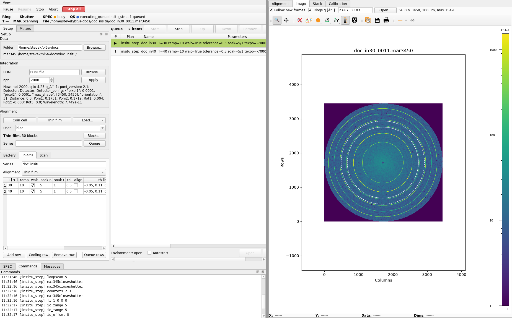

# BL5A automation

One GUI that queues alignment and mar345 measurements at BL5A, integrates
each frame with rsFAI, and stacks the profiles by time and temperature.
It covers the two experiments in `5a.zip`:

- **Battery (charge/discharge):** `coin_align`, then `mymar1` (one frame) or
  `mymar` (a frame every Ti minutes). The cycler is run from its own laptop.
- **Thin film vs temperature:** `myinsitu`: for each temperature `settemp`,
  then `align_in.mac`, then `mymar_in`.

Only what these two flows use is built: no general scan screen, no
re-integration, no macros outside the two flows.



## How it fits together

```
  beamline                                  simulation
  SPEC (kappa -S <port>) ─┐                  ┌─ bl5a-sim (one process, one world state)
   └ LakeShore 331 (ser 9)│ only this edge   │    SPEC server face (LakeShore on its ser 9)
  mar345dtb (:5001) ──────┘ is swapped       └─   mar345dtb face (:5001)
          │
  spec-ioc       motors, scaler and command records over SPEC   BL5A:SPEC:*
  mar345-ioc     ADmar345 (the beamline already runs one)       BL5A:MAR345:*
          │ Channel Access
  bl5a-qs        bsrs queue server: the three plans
          │ documents (ZMQ PUB) ──── bl5a-integrator (rsFAI) ── stacks (REP), new rows (PUB)
          │ control (ZMQ REP)                 │
  GUI (Python Qt) ────────────────────────────┘
```

The queue and the integrator keep running when the GUI is closed. A
temperature step, its alignment and its frames run inside one plan, not
in the GUI.

## What is in this directory

| Path | What it is |
| --- | --- |
| `sim/` | `bl5a-sim`: a SPEC server and a mar345dtb over one simulated beamline |
| `qs/` | `bl5a-qs`: the bsrs queue server with the plans `align` (a block sequence), `mar_series`, `insitu_step`, `scan` (one scan, an alignment scan block's fields) |
| `integrator/` | `bl5a-integrator`: integrates each frame, keeps one HDF5 stack per series and q axis in the series' data folder |
| `drivers/spec/` | the SPEC server protocol (`protocol/`, shared with bl5a-sim) and the SPEC client asyn driver (`driver/`) |
| `iocs/spec-ioc/` | `spec-ioc`: SPEC's motors, counters and command line as EPICS records |
| `ioc/spec/` | `st.cmd` and substitutions for spec-ioc (prefix `BL5A:SPEC:`) |
| `ioc/mar345/` | `st.cmd` for mar345-ioc (prefix `BL5A:MAR345:`), for the simulation |
| `deploy/` | `install.sh`, the user systemd services, the settings templates, the GUI's desktop shortcut and the GUI's and MCP server's launchers |
| `gui/` | the Python Qt GUI (`gui/run_gui.py`), its MCP server for Claude Code or Codex (`gui/run_mcp.py`), their tests and the vendored bl7c widgets |
| `.mcp.json` | Claude Code's entry for the MCP server (`deploy/bl5a-mcp`), with this machine's paths |
| `ref/spec/` | the beamline's SPEC config `kappa.config` (bl5a-sim reads it), the macro extractor for the SPEC state files in `261104_spec_d.tar.gz`, and splot's peak code |
| `doc/usage.md` | how to use the GUI, with screenshots |
| `doc/install.md` | how to build it and install it at the beamline |
| `doc/design.md` | the design notes (Korean) |

`deploy/install.sh` builds mar345-ioc from
https://github.com/epics-rs/epics-rs-iocs at the commit `Cargo.toml`
pins. See [doc/install.md](doc/install.md).

## Quick start with the simulation

It needs the Rust toolchain (rustup), a C/C++ compiler, network access to
github.com and crates.io, and a Python 3 with the GUI's packages (versions
in [doc/install.md](doc/install.md)).

Install once, then start the services:

```sh
deploy/install.sh --sim --python /path/to/python
systemctl --user enable --now bl5a.target
```

`install.sh` builds everything in release mode, writes the settings to
`~/.config/bl5a/`, installs five user services and puts a **BL5A**
shortcut on the desktop and in the applications menu. The `systemctl`
line starts the services now and again at every login:

| Service | What it runs |
| --- | --- |
| `bl5a-sim` | the simulated beamline: SPEC server on port 16510, mar345dtb on 5001 |
| `bl5a-spec-ioc` | spec-ioc, `BL5A:SPEC:*`, Channel Access on port 25064 |
| `bl5a-mar345-ioc` | mar345-ioc, `BL5A:MAR345:*`, Channel Access on port 25066 |
| `bl5a-qs` | the queue server |
| `bl5a-integrator` | the integrator |

Then open the GUI with the **BL5A** shortcut. Claude Code started in this
directory finds the MCP server through `.mcp.json`.

The data goes to `~/bl5a-data`: each queue item gets a folder there,
named after its series, holding its frames, its scans as a SPEC file and
its integrated stacks. The Channel Access ports keep the simulation off
the site network.

```sh
systemctl --user status 'bl5a*'             # what runs
journalctl --user -u bl5a-qs -f             # one service's log
systemctl --user restart bl5a.target        # after changing ~/.config/bl5a/*.env
systemctl --user disable --now bl5a.target  # stop them, and not at the next login
set -a; . ~/.config/bl5a/bl5a.env; set +a   # CA settings, for caget
```

The simulation's options go in `BL5A_SIM_ARGS` in
`~/.config/bl5a/bl5a.env`: `--sample coin` simulates a coin cell instead
of a film, `--seed N` fixes the simulated offsets, `--pos tth=81` sets a
start position and `--config FILE` takes another SPEC config (for example
with faster motors). `bl5a-sim --help` lists the rest.

## Tests

```sh
cargo nextest run --workspace
QT_QPA_PLATFORM=offscreen PYTHONPATH=gui python -m pytest -q gui/tests
```

## Limits

- The temperature IOC (`BL5A:TC:*`) is not built. `insitu_step` sets the
  temperature with the SPEC macros in `temperature.mac` on the LakeShore
  331's serial line, and the GUI's temperature field reads "—".
- No suspenders: a beam dump does not pause a plan.
- **Align position** and **Measure position** are disabled until BL5A gives
  the positions.
- The simulation serves no ring current or shutter PV, so those fields read
  "—" there.
