# Using the BL5A GUI

This is the operator's guide to the windows: what each part shows, what
each button sends, and the two experiments from start to end. To build
the programs and set them up at the beamline, see [install.md](install.md).

The screenshots were taken against the simulation (`bl5a-sim`), so the
ring current, shutter and temperature fields read "—" in them.

## Before you start

The GUI is a client. On its host, user systemd keeps spec-ioc, `bl5a-qs`
(the queue server, which runs the plans) and `bl5a-integrator` (which
integrates each frame) running ([install.md](install.md), section 5); the
beamline runs the mar345 IOC. You start SPEC in server mode, then the GUI
with the **BL5A** shortcut on the desktop or in the applications menu.
`systemctl --user status 'bl5a*'` shows whether the services run.

In a terminal, `deploy/bl5a-gui` starts the same GUI and takes these
options:

| Option | Default | What it is |
| --- | --- | --- |
| `--qs-control` | `tcp://localhost:60715` | bl5a-qs control socket |
| `--qs-documents` | `tcp://localhost:60725` | bl5a-qs document stream |
| `--integrator-rep` | `tcp://localhost:60735` | integrator requests |
| `--integrator-pub` | `tcp://localhost:60745` | integrator new rows and errors |
| `--user` | `bl5a` | the name in the queue's User column |

You can close the GUI at any time. The queue keeps running in bl5a-qs and
the stacks stay with the integrator. The GUI starts again with an empty
Alignment tab and empty Commands and Messages panes: they are filled
from what the plans report while the GUI is open. The Stack tab asks
the integrator, so it shows every stack it holds.

## The windows

The GUI opens two windows side by side: the main window, which runs the
experiment, and the plots window.

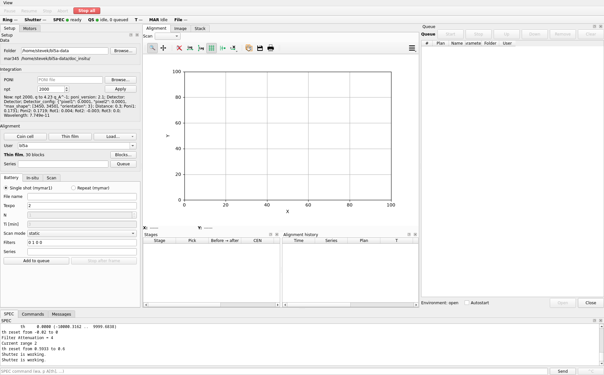

| Area | What is in it |
| --- | --- |
| Top | the View menu, the run buttons (Pause, Resume, Stop, Abort, Stop all) and the status line |
| Left | the Setup pane: the Data and Integration boxes, the Alignment box, the Battery, In-situ and Scan forms |
| Centre | the Motors pane over the Queue |
| Bottom | the SPEC console, the Commands the plans sent, the GUI's Messages, as tabs |
| Plots window | the Alignment tab: the scan plot, with the Stages of the running alignment and the Alignment history below it; the Image, Stack and Calibration tabs |

The Stages and Alignment history panes belong to the Alignment tab, so
the Image, Stack and Calibration tabs have the whole plots window to
themselves.

The first start puts the plots window beside the main window, as tall,
out to the right edge of the screen; with a second screen it can take
that screen. Closing it only hides it: **View → Plots window** shows it
again. Closing the main window closes both.

Every pane has a title bar. Drag the edge between two panes, or between
a pane and the queue or the scan plot, to resize them; a pane
smaller than its contents scrolls them. Drag a title bar to another
side, or onto another pane to share its place as a tab; the Stages and
Alignment history panes move only inside the Alignment tab. The
button left of × on the title bar, or a double click on the title bar,
floats the pane as a window of its own, which can go to another screen;
the same again docks it back. × closes the pane. The **View** menu,
also on a right click on a docked pane's title bar, shows a closed pane
again, and **Reset layout** puts every pane and the plots window back
where the first start puts them. The next start opens both windows at
the size, place and layout they had when closed, kept in
`~/.config/bl5a/bl5a-gui.conf`.

### Who drives SPEC

SPEC runs one command at a time. While the queue runs a plan, the plan
owns SPEC, so the GUI greys out everything that would send SPEC a
command of its own: the motor tweak buttons, their step fields, the
scan plot's move buttons and the SPEC console's entry.

They are live only when all of these hold:

- bl5a-qs is idle and runs nothing;
- spec-ioc reports SPEC connected (`BL5A:SPEC:Connected`);
- SPEC is ready (`BL5A:SPEC:Busy`);
- no console command is running (`BL5A:SPEC:Cmd:Busy`).

The queue itself can be edited at any time.

## Status line


| Field | Shows |
| --- | --- |
| Ring | the ring current, mA (`BL5A:userCalcOut1.VAL`) |
| Shutter | the front-end shutter; its PV is not configured yet, so "—" |
| SPEC | ● ready (green), ● busy (orange), ● disconnected (red); "—" when spec-ioc does not answer |
| QS | the queue server's state, the running plan, how many items wait; "environment closed" and "stopping after the frame" when they apply; ● not answering (red) when bl5a-qs does not reply |
| T | the temperature as readback → setpoint, and the ramp; "—" until the temperature PVs are configured |
| MAR | the mar345 detector state (`DetectorState_RBV`) |
| File | the full path of the last frame; you can select and copy it |

The QS dot is green when idle, orange when paused and blue otherwise.

## Run buttons

| Button | Live when | What it does |
| --- | --- | --- |
| Pause | a plan runs | pauses at once; a moving motor is stopped |
| Resume | paused | goes on |
| Stop | a plan runs or is paused | ends the plan, recorded as a success |
| Abort | a plan runs or is paused | asks first, then ends the plan, recorded as aborted |
| Stop all (red) | always | does not ask: sends SPEC ^C, which stops every motor SPEC moves, a count and SPEC's command, and aborts the plan if one runs or is paused |

However a plan ends, bl5a-qs then interrupts a SPEC command still
running, stops a count still running and closes the mar345 shutter.

**Stop all** is for when something goes wrong: a motor heading the wrong
way, a macro run from SPEC's own terminal, a plan doing what it should
not. The ^C reaches SPEC through spec-ioc whatever qs is doing, so it
works with qs stopped too. If spec-ioc is not connected, a warning says
SPEC got no ^C; stop the motors at SPEC's own terminal then.

The plans do not replay a SPEC macro that was cut in half. After
**Pause**, **Resume** fails the plan with "plan interrupted: a paused
plan cannot resume, abort it"; end it with **Stop** or **Abort**. To end
a battery series cleanly, use **Stop after frame** on the Battery form
instead: that pause lands between frames, where the series can go on.

A motor's stop reaches SPEC as `abort_all`, which stops every motor SPEC
is moving.

The queue's own **Stop** is different: it lets the running item finish
and then stops the queue.

The mar345's motors (`martran marz marsdd marshut marx ipbsx ipbsy`)
move only with tth at 83 or above, and tth goes below 83 only with
martran at 1200 or above. A move from the GUI or a plan that would break
this is refused and the SPEC log says why, for example `marz move
refused: tth 1 is below 83`. The motor stays where it was, so a plan
fails (`martran stopped at 1234, not 1250: 16000 steps off`) and the MCP `tweak` returns
an error. The motor's record has a MAJOR alarm until the motor next
moves, and its setpoint goes back to the readback, so the next ◀ or ▶
steps from where the motor is. SPEC's own moves (a macro, a command)
cannot be refused: once one breaks the rule, spec-ioc sends SPEC a ^C,
which stops every motor, and logs `interlock: …; sent ^C`. tth then
stops a little below 83; move tth up before moving the mar.

## Motors

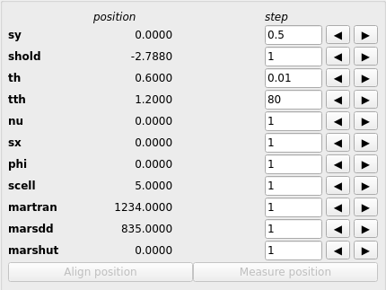

One row per motor the plans move: `sy shold th tth nu sx phi scell
martran marsdd marshut`.

- **position** is the readback, with the record's precision and unit.
- An orange dot after it means the motor is moving.
- **step** is the tweak step (the motor record's `TWV`). Type a positive
  number and leave the field (Tab or click elsewhere) to set it.
- **◀** moves the motor by −step, **▶** by +step. spec-ioc turns each
  into a SPEC move.

**Align position** and **Measure position** stay disabled until BL5A
gives these positions.

## Data

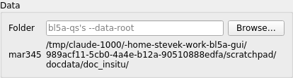

Everything an item records goes in one folder, `<data root>/<series>/`:
its frames, its scans as the SPEC file `<series>.spec` and its
integrated stacks. bl5a-qs makes the folder when the item starts. The
series is the one typed in the form, or the plan's name when there is
none, so the items of one series share a folder. Type the same series
in **Alignment** and on the **Battery** form and a cell's alignment
scans and frames land together:

```
<data root>/
  cell7/
    cell7.spec              the alignment scans
    cell7_0001.mar3450 …    the frames
    cell7.h5                the stack
  film_A/
    film_A.spec             each in-situ row's alignment scans
    filmA_30_0001.mar3450 …
    film_A.h5
```

- **Folder** is the data root of the items queued from now on; empty
  means bl5a-qs's `--data-root`. **Browse…** picks it, and the GUI
  remembers it. It must be an absolute path without spaces that is the
  same on the bl5a-qs, mar345 IOC and integrator hosts (see
  [install.md](install.md#1-what-runs-where)).
- Each queued item carries the folder as it was when queued, so a
  change does not move items already in the queue. The queue's
  **Folder** column shows where each item goes.
- **mar345** is the folder the mar345 IOC writes to now
  (`FilePath_RBV`); bl5a-qs sets it before each frame. A red
  "missing" after it means the IOC does not see that folder
  (`FilePathExists_RBV` reads No).

A series is one folder name without spaces, `/` or control characters,
and not `.` or `..`; the whole folder, `<data root>/<series>`, is at most
200 bytes. The mar345 detector server takes a frame's path as one word,
so a space would split it. The forms refuse any other series, and
queueing refuses a **Folder** with a space or a path that is too long.
In the stack's file name, a character other than a letter, digit, `_`,
`-` or `.` is written `%XX`: series `LiFePO4(1C)` gives
`LiFePO4%281C%29.h5`. An item whose data root does not exist fails when
it starts, with "data folder: … the data root … does not exist".

## Integration

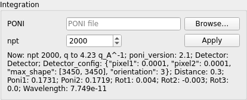

The text under the buttons is what the integrator integrates with now:
npt, the q range and the PONI.

| Control | What it is |
| --- | --- |
| PONI | a pyFAI PONI file for the full 345 mm plate; **Browse…** picks it |
| npt | the bins from q = 0 to the plate's far rim (default 2000) |
| Apply | reads the file and sends its text and npt to the integrator |

**Save and apply…** on the [Calibration tab](#calibration-tab) puts
the refined PONI's file in PONI and applies it the same way.

The integrator checks them first: a PONI it cannot use is refused, and
the box adds "Refused:" and the reason. An accepted one applies to the
frames after those already waiting to be integrated; until then the
box shows it as "Next, after the queued frames". When it takes effect,
Messages says "integrator: npt …, q to … from now on" and the Image
tab's rings move to the new PONI.

A new npt, or a PONI that moves the q range, starts a new stack: the
next frame of `cell7` goes to `cell7~2.h5`, and `cell7.h5` keeps its q
axis. The Stack tab lists both. The integrator keeps the setting until
it restarts, and then starts again from its `--poni` and `--npt`.

## Queue

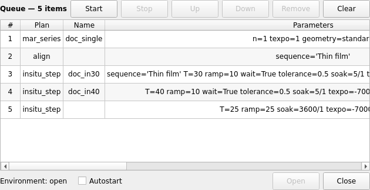

The top row, marked ▶ on a green background, is the running item; the
rest wait in order.

| Column | Shows |
| --- | --- |
| # | the place in the queue |
| Plan | `mar_series`, `align`, `insitu_step` or `scan` |
| Name | the frame file name, when the plan takes frames |
| Parameters | the item's arguments, for example `sequence='Thin film' T=30 ramp=10 wait=True tolerance=0.5 soak=5/1 texpo=-70000 th_list=-0.05/0.11/0.13/0.15` |
| Folder | where the item's data goes: `<data root>/<series>`, or the series alone when the item goes to bl5a-qs's `--data-root` |
| User | the `--user` that queued it |

| Button | What it does |
| --- | --- |
| Start | runs the queue from its first item (only with items and nothing running) |
| Stop | stops the queue after the running item; that item is not interrupted |
| Up, Down | moves the selected item one place |
| Remove | takes the selected items out (also the Delete key); not the running item |
| Clear | empties the queue after asking; the running item goes on |

The row under the list belongs to the queue server:

- **Environment: open / closed / not known.** Nothing runs while it is
  closed. **Open** opens it. **Close** is offered only while idle.
- **Autostart.** When ticked, what is added to the queue runs without a
  Start. The server unticks it when the queue ends in any way other than
  running dry: a failed or aborted plan, or a Stop. Tick it again here.

A click on a form's queue button sends one request. The rows of the
In-situ table go in as one request, in table order, so nothing can slip
in between them.

bl5a-qs checks an item's arguments only when the item runs. The forms
check the same rules before they queue, so a bad value is caught at the
form and not halfway through the night.

## Battery measurements

The Battery form queues `mar_series`: SPEC's `mymar1` (one frame) or
`mymar` (a frame every Ti minutes).

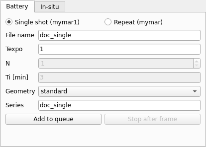

| Field | Rule | Notes |
| --- | --- | --- |
| Single shot / Repeat | | Single shot is `mymar1`; Repeat is `mymar` |
| File name | 1 to 27 characters, no spaces or quotes | the mar345 file name |
| Texpo | seconds 1 to 20, or a negative number of monitor counts | default 2 |
| N | whole number, at least 1 | Repeat only: the number of frames |
| Ti [min] | more than 2.5 | Repeat only: from one frame's start to the next |
| Scan mode | `static`, `rocking1`, `rocking2` | the macro each frame is taken with: `mar345expose` (still), `mar345_lab6` (th and phi rock from −1° to +1°), `mar345_lab6_wide` (−5° to +5°) |
| Filters | four blades, `0` or `1` each | SPEC's `fi` before the frames: the PFCU0 filters, default `0 1 0 0` |
| Series | a folder name ([Data](#data)) | the data folder and stack the frames go to; empty means the file name |

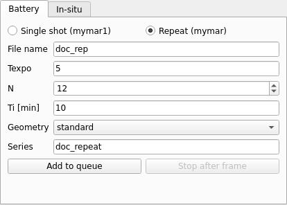

**Add to queue** checks the fields first. A bad value opens a "Battery"
box that names the field and the rule. Then the GUI asks:

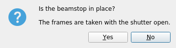

**Yes** queues the item; **No** queues nothing.

**Set the geometry first.** `mar_series` moves neither tth nor the mar's
motors: the frames are taken where they stand.

What a `mar_series` does, in order:

1. `mar345closeshutter`, `scell` to 0, `counters 2 3`, `fi <filters>`,
   `ic_range 4`, a 2 s wait, `scell` to 0.
2. For each frame: the item's data folder goes to the mar345 IOC's
   FilePath, then the scan mode's macro (`mar345expose`, `mar345_lab6`
   or `mar345_lab6_wide`) with `("<name>", <texpo>)` names the file,
   works the shutter, rocks th and phi in the rocking modes, counts, logs
   `exp_condition`, has the plate read out and runs `mar345readout`.
3. Frame *i* starts *i*·Ti after the first frame. Between frames the plan
   only waits.

The mar345 writes `<name>_<number>.mar3450` in the item's data folder.
The number is the IOC's file counter, which runs on from one name to
the next.

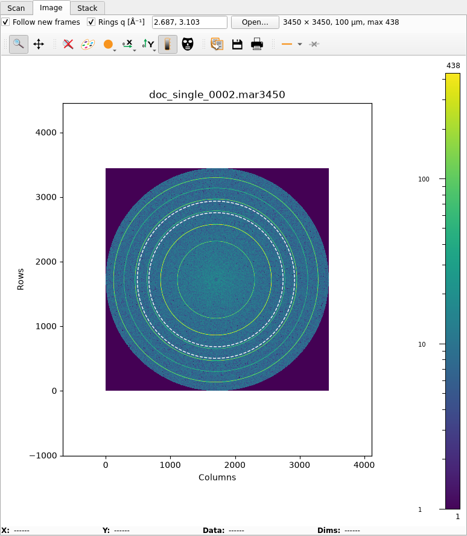

Each frame appears on the Image tab once it is read out, and is added
to its series on the Stack tab once the integrator has integrated it.

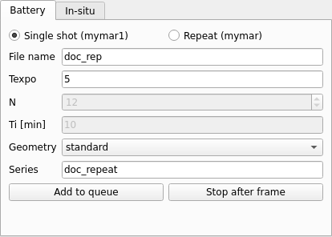

**Stop after frame** is live while a `mar_series` runs. It lets the
frame being taken finish, then ends the series: it asks for a pause that
takes effect between frames, and sends Stop once the plan has paused. The
status line says "stopping after the frame" in the meantime.

## Alignment

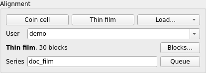

An alignment is a sequence of blocks run in order. Two sequences come
with the GUI and are read-only: **Coin cell**, SPEC's `coin_align`, and
**Thin film**, SPEC's `align_in.mac`. Each user's own sequences are
kept in the Data folder, one file each,
`<data folder>/alignments/<user>/<name>.json`.

The box names the sequence last loaded and how many blocks it has; the
GUI starts with Thin film. Its blocks are edited in a window of their
own, [Blocks](#the-blocks-window).

| Field | What it does |
| --- | --- |
| Coin cell, Thin film | loads that sequence's blocks and opens the Blocks window |
| Load… | the same for one of the User's saved sequences, picked from its menu |
| User | whose sequences Load…, Save and Delete use; type a name, or pick one that has saved sequences; empty: `bl5a` |
| Blocks… | opens the Blocks window again |
| Series | groups the runs in the alignment history, is stored with the run and names the data folder its scans go to; empty means each run stands on its own, its scans in the folder `align` |
| Queue | queues the plan `align` with the blocks loaded, changed or not |

The name has `*` after it while the blocks have unsaved changes.
Queued so, the run records the name with "(edited)", for example
`Thin film (edited)`. The item carries the blocks, so a change made
after queueing does not change the queued item. Loading
another sequence, or closing the GUI, asks before dropping unsaved
changes. Every alignment ends by recording sx, sy, shold, th and phi;
the history shows sy and shold.

### The Blocks window

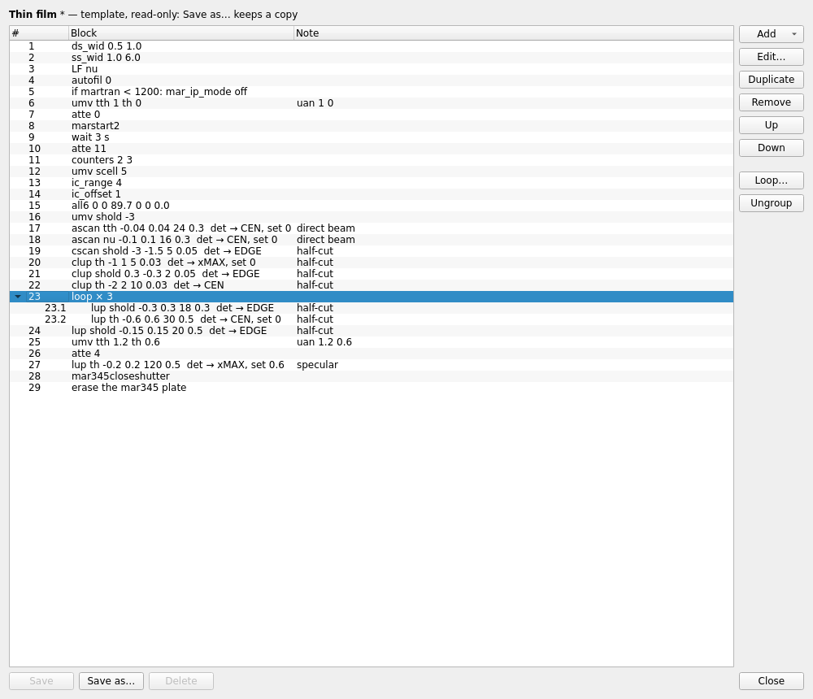

Each row is one block: its number (#), then the SPEC line it sends, or
the scan it runs as the Stages table names it with the counter and
where the motor goes, then its note. A loop's blocks are under it,
indented and numbered inside it: 4.2 is block 2 of the loop block 4, as
an error names it ("block 4 (loop) block 2 (scan): …"). Closing the window keeps
the blocks loaded.

Select a row, or neighbouring rows in one list (Shift-click); a
selected loop counts with the blocks inside it. Then:

| Button | What it does |
| --- | --- |
| Add | a new block of the kind picked from its menu, after the selected ones, in their list |
| Edit… | the current block's form (or double-click the row) |
| Duplicate, Remove | copies or removes the selected blocks; a loop left with none goes too |
| Up, Down | moves them one place within their list |
| Loop… | puts the selected blocks into one loop block that runs them in order, the number of times asked |
| Ungroup | puts the selected loop's blocks in its place, run once; its times, Only when and note go |
| Save | writes the sequence under its name; not for Coin cell or Thin film |
| Save as… | writes it as the user's under a new name; asks before replacing one |
| Delete | deletes the user's saved sequence and loads Thin film |
| Close | closes the window |

Saving needs a Data folder. A name is 1 to 64 characters,
not starting with `.`, without `/` or `\`, and not Coin cell or Thin film.

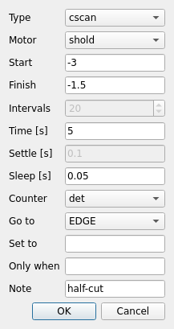

| Block | Fields | What it does |
| --- | --- | --- |
| scan | type, motor, start, finish; count (ascan, lup: seconds per point, or monitor counts on icxrd, SPEC's MON, which SPEC shows as a negative count time; cscan, clup: seconds of the whole move); intervals and settle (ascan, lup) or sleep (cscan, clup); counter; go to; of a dip; set to | scans, checks the scan ([Before a stage moves](#before-a-stage-moves)), moves the motor to the statistic picked in go to and, when set to has a value, redefines that position with `set`; ascan and cscan are absolute, lup and clup relative to where the motor is |
| move | motor position pairs, `tth 1 th 0` | `umv` of them together |
| spec | one command line | sends it to SPEC |
| wait | seconds | waits |
| erase | | erases the mar345 plate |
| loop | times | runs its blocks in order, that many times over; made with Loop…, its blocks edited in the list; loops may hold loops |

Any block can also have **Only when**, for example `martran < 1200`: the
block runs only while the motor is below (`<`) or above (`>`) the value;
a loop's is checked once, before it starts.
**OK** checks the block as bl5a-qs will and names the field that breaks
a rule. Each scan block is one row of [Stages](#stages).

### Coin cell

SPEC's `coin_align`:

1. `marshut` to 0, `mon1_setup 1050 100 300 3.0 1.0`, `setkappa 50`,
   `counters 2 5`, `fi 1 0 0 0`, `fil 0 0 0 0`.
2. A fly scan of sy from −2.5 to 2.5 on ic1; sy goes to pl_COM.
3. A fly scan of shold from −2 to 2; shold goes to pl_COM.
4. `mar345closeshutter`, the plate is erased, `marshut` to 340.

`coin_align` ends with `mar_ip` without arguments, which only prints its
usage in SPEC, so the sequence does not send it.

### Thin film

SPEC's `align_in.mac`. It sets the slits, attenuators and counters
(`mar_ip_mode off` only when martran is below 1200), moves to the direct
beam (`uan 1 0`, `all6 0 0 89.7 0 0 0.0`, `shold` to −3) and then runs
these stages. Each stage scans, moves the motor to the picked statistic
and, where a value is given, redefines that position with `set`.

| Stage | Pick | Then |
| --- | --- | --- |
| tth −0.04 to 0.04 | CEN | `set tth 0` |
| nu −0.1 to 0.1 | CEN | `set nu 0` |
| shold −3 to −1.5, fly | EDGE | |
| th −1 to 1 relative, fly | pl_xMAX | `set th 0` |
| shold 0.3 to −0.3 relative, fly | EDGE | |
| th −2 to 2 relative, fly | CEN | |
| shold −0.3 to 0.3 relative | EDGE | |
| th −0.6 to 0.6 relative | CEN | `set th 0` |
| shold −0.15 to 0.15 relative | EDGE | |
| `uan 1.2 0.6`, `atte 4`, then th −0.2 to 0.2 relative, 120 intervals | pl_xMAX | `set th 0.6` |

It ends with `mar345closeshutter` and an erase of the plate.

EDGE is where a shold scan falls through halfway between its maximum
and its floor, the height at which the sample takes half the beam. The
floor is the scan's minimum when at least 3 of the 25 bins lie within 3
times the noise of a difference of two bins of the lowest; a scan that
ends on the slope shows no floor, and it is taken as zero. `align_in.mac`
moves to CEN, which
for an edge lies halfway between that point and the maximum, and on the
open-beam plateau the maximum is wherever the noise puts it: over four
scans of one edge on the beamline CEN moved by 0.24 while the half point
stayed within 0.007.

A scan block with **of a dip** checked goes to CEN, COM or xMAX of a
dip: of the scan turned over, its maximum less each point, so the dip's
bottom is the maximum and the plateau around it zero. CEN is then the
centre at half the dip's depth and xMAX the scan's minimum. EDGE has no
dip form.

### Before a stage moves

A point more than 3σ from the median of itself and the two points either
side of it is replaced by that median, and so is a point that is not a
number. σ is that of the five points, but at least the square root of
their median and the noise of the whole scan. A cscan's second sample
counts about 1.7 times as long as the others and is often replaced this
way; left in, it can be the maximum CEN and pl_xMAX follow. The
statistics are those of the filtered points.

The stage then puts the motor back where it was before the scan and
ends the plan, which fails with the reason Messages shows, when

- the scan shows nothing: averaged into 25 bins, it changes by less than
  10% of its largest bin, or by less than 5 times the noise of a bin;
- a peak's maximum is the scan's first or last point, or both of its
  neighbours are at or below half of it (a peak one point wide); for a
  dip, the same of the scan turned over: the minimum is an end point, or
  the dip is one point wide at half its depth;
- the bins on either side of a peak's largest bin do not fall below it
  by more than 3 times the noise of a difference of two bins: the peak
  may lie past the end, with the end point's noise putting it below the
  one before;
- an edge never falls to half its maximum, or falls to half on both
  sides. A step that does not fall to half, such as a sample that takes
  a fifth of the beam, is not taken for an edge over a high floor.

A peak that never falls to half inside the scan, such as a rocking curve
wider than a th scan, still goes to CEN, which is then the maximum.

### Stages

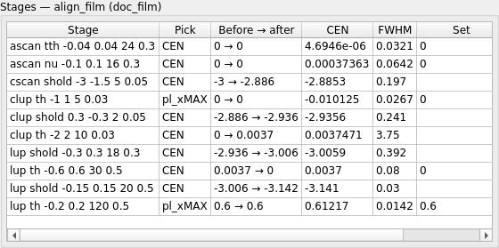

The Stages table shows each stage of the alignment running now. Its
title names the plan, the sequence and the series. It is cleared when
the next `align` or `insitu_step` starts, including an `insitu_step`
row without alignment.

| Column | Shows | Tooltip |
| --- | --- | --- |
| Stage | the scan, as a SPEC command line | |
| Pick | the statistic the motor was moved to: CEN, pl_COM, pl_xMAX or EDGE, followed by `dip` for a dip | the target position |
| Before → after | the motor before the scan, and after the move and any `set` | |
| CEN | the centre at half maximum | COM and the position of the maximum |
| FWHM | the full width at half maximum | |
| Outliers | how many points the outlier filter replaced | |
| Set | the value given to `set`, empty when the stage did not set | how far the user offset moved |

The statistics are splot's (`CEN`, `pl_COM`, `pl_xMAX`), the ones SPEC's
macros read, of the points after the outlier filter (see
[Before a stage moves](#before-a-stage-moves)); a dip's are of those
points turned over.

### Alignment history

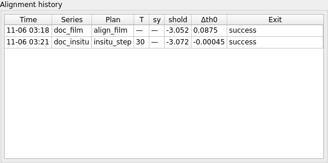

One row per finished run that aligned:

| Column | Shows |
| --- | --- |
| Time | when the run started |
| Series | the series it was queued in |
| Plan | `align` or `insitu_step`, with the sequence it ran |
| T | the `insitu_step` setpoint, °C |
| sy, shold | where the run left them |
| Δth0 | how far this run moved th's zero |
| Exit | `success`, `fail` or `abort`; its tooltip gives the reason a run did not succeed |

Δth0 is the sum of this run's `set th` corrections, not th0 itself:
SPEC's dial position is not published, so the absolute offset is not
known to the GUI.

## Alignment tab

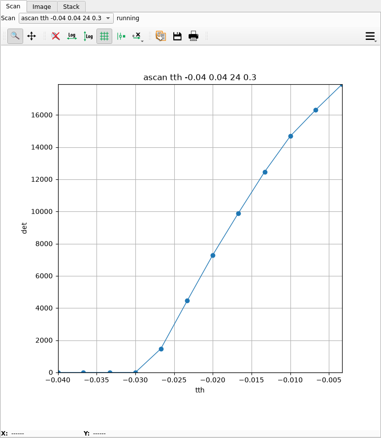

A scan is drawn point by point as it runs, at most five times a second.
A fly scan runs in SPEC, which keeps its sampling timing; each of its
points is drawn as SPEC takes it (spec-ioc passes on SPEC's `SCAN_PT`
events), and is the counts SPEC took in one sample, at the middle of the
motor's travel over it. When SPEC finishes, its full table of the scan
adds any point not seen yet; a table that does not begin with the
points already drawn fails the scan.

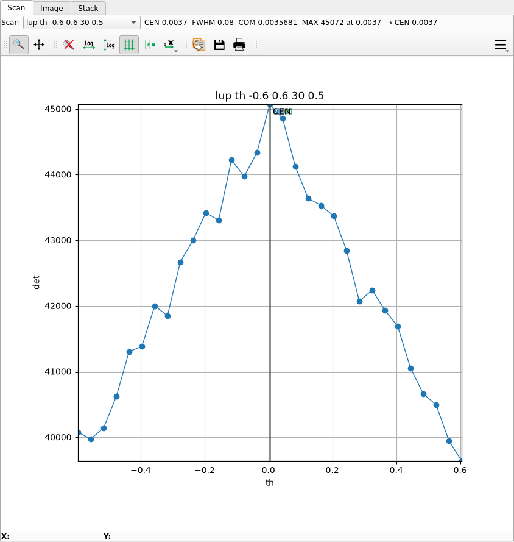

When the scan ends, the line above the plot gives CEN, FWHM, COM and the
maximum and its position, and markers are drawn: CEN red, COM green, MAX
blue, and the stage's target black with the pick's name. In the picture
the stage picked CEN, so the black target lies on the red CEN line. A
stage's scan shows the stage's statistics, of the points after the
outlier filter, and how many points the filter replaced; the curve is
the points as taken, so where a point was replaced the markers can lie
off it. A dip's stage gives DIP, its depth, and its position for the
maximum, and marks the minimum MIN. Any other scan shows the statistics of its points as taken. A
scan that did not end in success shows its exit
status and why; the whole line is in its tooltip when it does not fit.

The buttons right of the **Scan** list, **th → CEN**, **th → COM** and
**th → MAX** (named after the scan's motor, and **MIN** for a dip),
move the motor to the drawn CEN, COM or maximum, as SPEC's `CEN`,
`pl_COM` and `pl_xMAX` do after a scan; the tooltip gives the position.
The move goes to the motor record, as the Motors pane's ◀ ▶ do, so it
is live only when SPEC takes commands (see
[Who drives SPEC](#who-drives-spec)), and only for a finished scan of
one of the Motors pane's motors with that statistic. It works on any
scan picked in the **Scan** list. A stage with **Set to**, the scan's
own or a later one of the same motor, renumbers the motor's positions
by its target − set; the button goes to the same point in the new
numbers, and its tooltip gives both. A `set` typed in the SPEC pane or
sent by a SPEC block is not seen. A move SPEC refuses adds a line to
**Messages**; the SPEC pane says why.

The **Scan** list keeps this window's last 100 scans; pick one to look
at it again. Every scan, from any window or none, is also appended to
the SPEC-format file of its item's data folder, `<series>.spec` (see
[Data](#data) and [install.md](install.md) section 4.5), for splot or
PyMCA. The toolbar is silx's: zoom, pan, log axes, grid, save, print.

The **Scan** form, on the left beside Battery and In-situ, queues one
scan as a `scan` item. Its boxes are an alignment scan block's (see
[The Blocks window](#the-blocks-window)): Type `ascan` or `cscan`
(positions; the motor stays at finish) or `lup` or `clup` (offsets from
where the motor is, and it goes back there after), a step scan's
intervals, count and settle, a fly scan's sweep time and sleep, and the
Counter whose statistics are taken. **Go to** `none` leaves the motor
where the scan left it; CEN, COM, xMAX or EDGE then moves it there, as
an alignment stage does, after the same
[outlier filter](#before-a-stage-moves), with **of a dip** and
**Set to** as in a block. **Attenuation** is the `atte n` the item
sends before the scan, the filters the beam is counted through; 11, as
align_in.mac's scans, is the default. After the scan the shutter is
closed and the plate, which the beam reached, erased, as an alignment
ends. The scan is drawn here, its target marked,
and goes to its series' `.spec` file like an alignment's scans; with no
Series it goes to the data folder `scan`. A scan item's move is not an
alignment stage: it is not in the Stages table or the alignment
history.

## In-situ (film against temperature)

The In-situ form is SPEC's `myinsitu` as a table. Each row is one
`insitu_step`; the rows run in order and their frames go to one series.

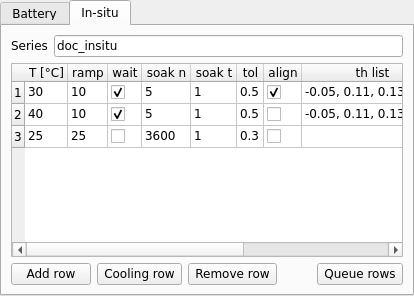

| Column | Default | What it is |
| --- | --- | --- |
| T [°C] | empty | the setpoint (`settemp T`); empty leaves the temperature alone |
| ramp | empty | °C/min (`set_ramp`) |
| wait | off | wait until T is reached (`changec T` instead of `settemp T`) |
| soak n | empty | `loopscan` points while soaking |
| soak t | empty | seconds per soak point |
| tol | 0.3 | with wait: how close to T counts as reached, °C (`changec`'s `DELTA_K`) |
| align | on | run the Alignment sequence before the frames |
| th list | -0.05, 0.11, 0.13, 0.15 | one frame at each th, comma separated; empty takes no frames |
| texpo | -70000 | seconds (> 0) or monitor counts (< 0) |
| name | empty | the frames' file name |

**Series** names the data folder and stack of every row; empty means
the first row's name. **Alignment** is the sequence each row with align
runs: Thin film, or one of the Alignment box's user's sequences.

One row runs, in order:

1. Temperature, only the parts filled in: `qdo` of the beamline's
   `temperature.mac`, `set_ramp <ramp>`, then `settemp T`, or with wait
   `changec T` with `DELTA_K` set to tol, then `loopscan n t`.
2. With align: the Alignment sequence ([Thin film](#thin-film) unless
   another is picked).
3. With a th list: `mymar_in`. If tth is below 40 it first closes the
   shutter, `uan 45 0`, takes tth to 83 and then the mar345 to the
   in-situ positions. Then `uan 83 0`, `counters 2 3`, `fi 1 0 0 0`,
   `ic_range 5`, `ic_offset 0`, `mar_ip7 25 440 42.4 340 81.8 1.2 -6.8`,
   5 s, `scell` to 0.9, a frame at each th, `ic_offset 1`,
   `fi 1 0 1 1`, the mar345 out of the way, tth to 42, and `uan 1 0`.
   The macro has 81 and moves tth with the mar345; the plan keeps to
   the mar345's interlock ([Run buttons](#run-buttons)).

| Button | What it does |
| --- | --- |
| Add row | an empty row with the defaults |
| Cooling row | `myinsitu`'s last step: ramp 25 °C/min to 25 °C, no wait, soak 3600 points of 1 s, no alignment, no frames |
| Remove row | removes the selected rows |
| Queue rows | checks every row, then queues them all in order |

The checks: name 1 to 27 characters without spaces or quotes (only when
the th list is not empty); texpo not 0; ramp above 0; wait needs a T;
with wait, tol above 0 (without wait tol is not used); soak needs both n (a whole number, at
least 1) and t (above 0); a row with no T, ramp or soak, no alignment
and no th list does nothing and is refused. A bad row opens an "In-situ"
box that names the row and the field; nothing is queued then.

The cooling row soaks for an hour. Queue it last.

## Image tab

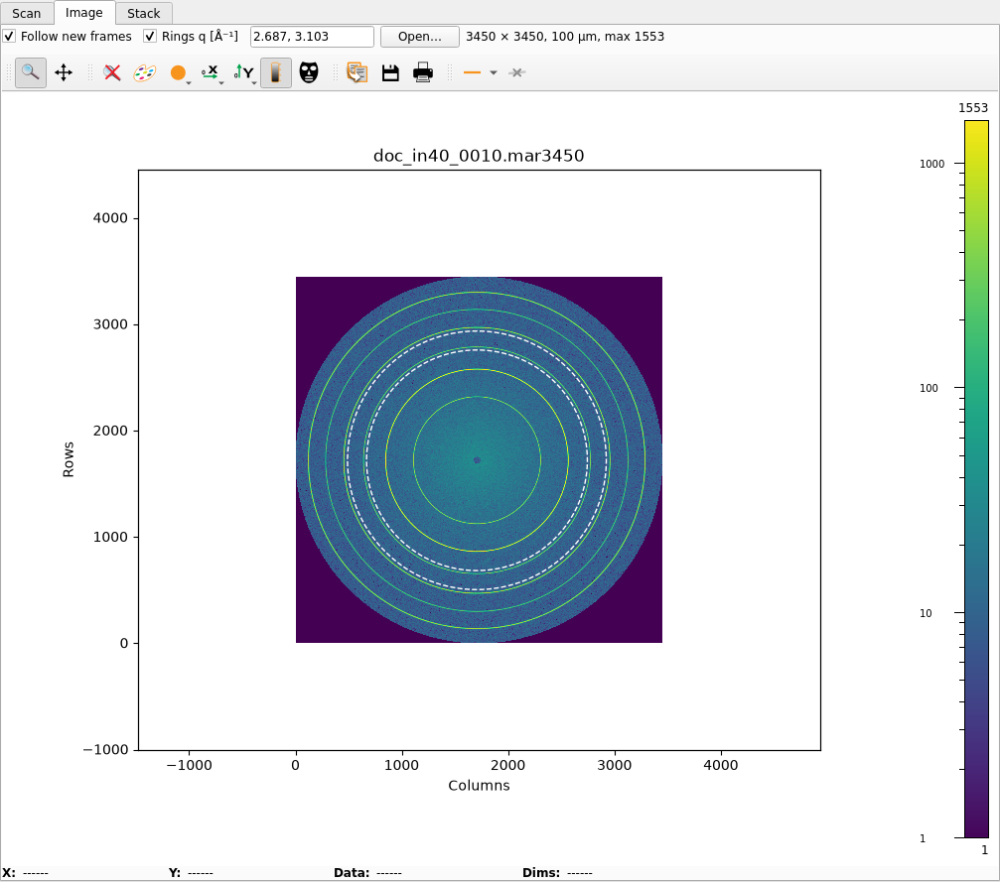

- **Follow new frames**: each new frame is loaded as it is written. The
  file is read off the GUI's thread, from the path the mar345 IOC
  reports, so that path must be readable on the GUI's computer.
- The image is drawn on a log colour scale; zero counts are drawn as 1.
- **Rings q [Å⁻¹]**: comma-separated q values, drawn as dashed white
  circles where the integrator's geometry puts them. The defaults are
  Al 111 and Al 200 (2.687 and 3.103). The simulated film in the picture
  has no aluminium, so its rings fall elsewhere.
- **Open…** loads any mar345 file.
- The line after the buttons gives the image size, the pixel size and
  the largest count, or the reason a file could not be read.

The rings use the integrator's PONI, which the GUI asks the integrator
for. The integrator uses one PONI for every frame, so the rings and the
stacks are right only for the detector position that PONI was measured
at (see [install.md](install.md#46-bl5a-integrator)).

## Stack tab

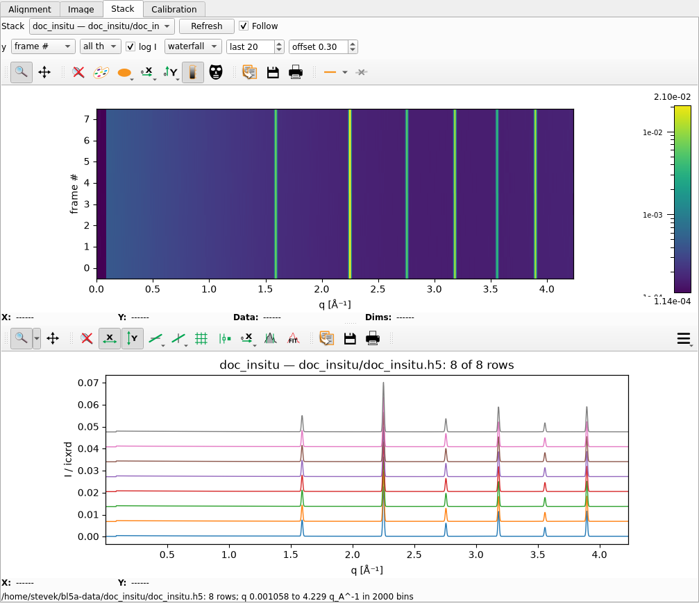

The integrator integrates every frame and appends it to its series'
stack in the item's data folder. A stack is one series on one q axis
(see [Integration](#integration)). The tab shows one stack:

- the heatmap: q across, one row per frame (or by time), log colour;
- the profiles: I / icxrd against q for the last N rows.

| Control | What it does |
| --- | --- |
| Stack | every stack the integrator holds, as `series — folder/file`, in path order; at start the last one is shown |
| Refresh | asks the integrator again for its settings and its stacks |
| Follow | each new row brings up its stack (default on) |
| y | `frame #`, or `time [min]` from the first frame |
| all th / th v | all frames, or only those taken at one th |
| log I | log colour scale (default on) |
| overlay / waterfall | profiles drawn on top of each other, or stepped up |
| last N | how many of the newest rows the profiles show (default 20) |
| offset | the waterfall step, as a fraction of the rows' median maximum (default 0.3) |

New rows arrive by themselves. A new stack shows up in the list when
its first frame is integrated. With Follow on, the tab shows the stack
of the newest row, new or listed; off, it stays on the stack shown, or
shows the new one when none was shown.

The line at the bottom gives the stack's file, its number of rows and
its q axis. It reads "integrator: not answering" when the integrator
does not reply. The integrator's settings are in the
[Integration](#integration) box.

The integrator reads a folder's stacks once, at its start or at the
folder's first row. A stack file deleted on disk while it runs stays in
the list until the series' next frame, which starts the file again.

## Calibration tab

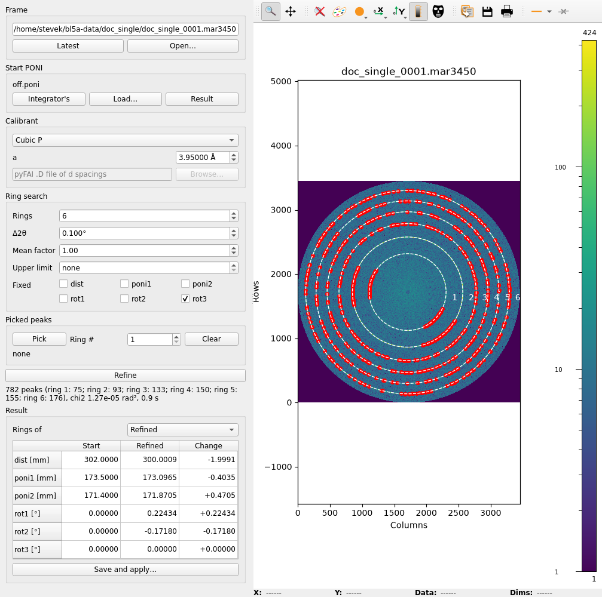

The tab refines the plate's PONI on a frame of a calibrant the way
Dioptas's automatic refinement does it; the integrator does the work,
with rsFAI. From the start PONI it searches the rings in turn, from the
innermost: the pixels within Δ2θ of a ring that stand above Mean factor
× the band's mean + its standard deviation give the ring's peaks, and
the geometry is refined on every peak found so far before the next
ring. Pixels off the scanned disc are left out.

| Control | What it does |
| --- | --- |
| Latest, Open… | loads the mar345's last frame, or any mar345 file |
| Integrator's, Load…, Result | the start PONI: the integrator's, which it follows as the integrator's changes; a PONI file of the full 345 mm plate; or the last refined one, to refine again from |
| Calibrant | LaB6, CeO2, Si (NIST SRM 660c, 674b, 640c) or Al, with pyFAI's d spacings; Cubic P: every hkl of the lattice constant a; .D file: a pyFAI d-spacing file |
| Rings | the rings searched, from the innermost (default 15); those the PONI's wavelength does not reach are left out |
| Δ2θ | the half width of each ring's band (default 0.1°) |
| Mean factor | default 1; Dioptas's 3 finds only the inner rings of the simulated frame, whose rings are broad |
| Upper limit | pixels above this count, saturated ones, are left out (default none) |
| Fixed | the parameters held at the start value; rot3 by default, which round rings barely show |
| Pick, Ring #, Clear | peaks picked by hand, below |
| Refine | sends the frame, the start PONI, the calibrant and the picks to the integrator |
| Rings of | the PONI the dashed rings are drawn with: Start, Refined, or none |
| Save and apply… | writes the refined PONI to a file and applies it as the [Integration](#integration) box's Apply does |

The line under Refine gives the peaks found on each ring, chi2 (the sum
of their squared 2θ misfits, rad²) and the seconds it took, or
"Failed:" and the reason. The peaks are drawn as red dots, the rings
move to the refined PONI, and the table gives the start, the refined
value and the change.

A start too far off puts the bands beside the rings, and the search
finds nothing or the wrong peaks. Then press **Pick**, set **Ring #**
(1 the innermost) and click on that ring in a few places, then on
another ring; each click takes the brightest pixel within 5 pixels,
drawn as an orange ×. The integrator refines the start on the picks
before the search. A second click within 0.4 s is a double click and
picks nothing. **Clear** drops the picks, as does a new frame.

**Save and apply…** offers the frame's name with `.poni`. The frames
after those already queued are integrated with the new PONI; the Image
tab's rings, the Integration box and an Integrator's start follow it
when it takes effect.

## SPEC console, Commands, Messages

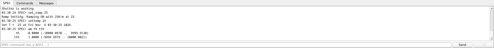

**SPEC** shows what SPEC prints, as spec-ioc's `Log` PV carries it, the
plans' output included. `--- N lines not shown ---` marks a burst longer
than the PV holds between two updates; `--- spec-ioc restarted ---`
marks an IOC restart.

The entry sends one SPEC command (Enter or **Send**) when the queue is
idle (see [Who drives SPEC](#who-drives-spec)). The command is echoed as
`HH:MM:SS SPEC> command`, followed by SPEC's reply. A command that does
not end OK adds a line with its status; one that could not be written to
SPEC, a line with why instead of a reply. **^C** interrupts the command
sent from here; it never touches a plan's command.

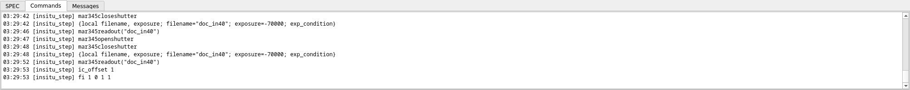

**Commands** lists every SPEC command a plan sent, with the time and the
plan, and its reply indented below.

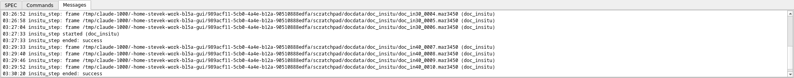

**Messages** is the GUI's own log: each queue request and its result,
each plan's start, each queue item's end with its exit status (and,
when it did not succeed, why), each frame with its series, and errors
from bl5a-qs and the integrator. A request bl5a-qs refuses also opens a
"bl5a-qs" box.

## Walkthrough: a battery cycle

1. Mount the coin cell. Check the **Data** folder. In **Alignment**,
   click **Coin cell** (or **Load…** a sequence of your own); its blocks
   open in the Blocks window, to change or just close. Type a series
   (for example the cell's name) and click **Queue**.
2. Click **Start** in the queue. The Alignment tab draws the sy and
   shold fly scans; the history gets a row with the sy and shold the run
   left.
3. With the queue idle, type `umv tth 83` in the SPEC console.
4. On the **Battery** form: a file name, Texpo, **Repeat** with N and
   Ti (or **Single shot**), the geometry and the same series, so the
   frames go to the alignment's folder. **Add to queue**, answer **Yes**
   to the beamstop question, then **Start**.
5. Start the cycler from its own computer.
6. Each frame shows on the **Image** tab and is added to the **Stack**
   tab; choose `time [min]` for y to follow the cycle.
7. To end before N frames, click **Stop after frame**.

## Walkthrough: a film against temperature

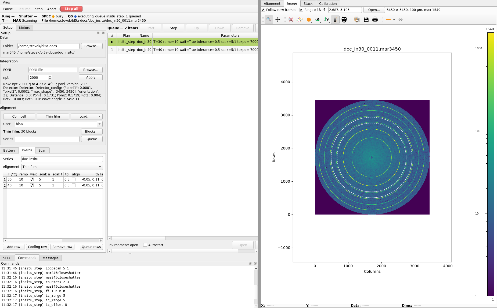

1. Mount the film. Check the **Data** folder and, for the detector
   position `mymar_in` uses, the **Integration** PONI. On the
   **In-situ** form, type the series and pick the Alignment sequence.
2. Fill one row per temperature: T, ramp, wait and tol, a soak if
   wanted, align, the th list, texpo and the file name. Add the
   **Cooling row** last.
3. **Queue rows**, then **Start**.
4. Each row sets the temperature, aligns (Alignment tab) and takes
   its frames (Image and Stack tabs). The history gets a row per aligned
   step with its T.
5. On the **Stack** tab, pick one th (for example `th 0.13`) to compare
   the same angle across temperatures.

## AI control (MCP)

`gui/run_mcp.py` gives Claude Code or Codex the GUI's controls as MCP
tools (setup: [install.md](install.md#48-mcp-server)). The client starts
it through `deploy/bl5a-mcp` when it starts in the `bl5a_gui` directory. It builds queue
items with the forms' own code, passes the same gate as the buttons and
writes only the PVs the GUI writes, so an item the AI queues is the item
the form would queue. It runs beside the GUI, and the GUI shows what the
AI queued and runs.

Ask in plain words, for example "queue a thin-film alignment for series
film3 and start it", "show me the last frame" or "what did the last fly
scan find?".

| Tools | What they do | In the GUI |
| --- | --- | --- |
| `status` | the queue's and SPEC's state, and `allowed`: the actions open now | status line; which buttons are live |
| `queue`, `history` | the waiting items; the finished ones with their exit status | Queue |
| `motors` | position, step and unit of each motor | Motors |
| `scans`, `scan`, `alignment` | the scans with their peak values and where each moved its motor; the stages and the alignment history | Alignment tab |
| `messages`, `spec_log`, `commands` | the three logs | Messages, SPEC, Commands |
| `frame_image` | the last frame, or a named one, as a picture | Image tab |
| `integration`, `stacks`, `stack` | the integrator's PONI and npt; the stacks; one stack's rows | Integration, Stack tab |
| `alignment_sequences`, `alignment_sequence`, `save_alignment_sequence` | a user's sequences; one sequence's blocks; save one as the user's | Alignment box: Load…; Blocks window: Save as… |
| `queue_alignment`, `queue_scan`, `queue_mar_series`, `queue_insitu` | queue items | Alignment Queue, Scan form, Battery form, In-situ form |
| `queue_remove`, `queue_move`, `queue_clear`, `queue_start`, `queue_stop`, `queue_autostart`, `environment_open`, `environment_close` | edit and run the queue | the queue's buttons |
| `pause`, `resume`, `stop`, `abort`, `stop_after_frame` | end or hold the running plan | Run buttons, Stop after frame |
| `tweak` | move a motor by a step | Motors ◀ ▶ |
| `spec_command`, `spec_result`, `spec_abort` | one SPEC command, its result, ^C | SPEC console |
| `stop_all` | SPEC's ^C for every motor, count and command, and an abort of the plan | Stop all |
| `integration_set` | a PONI file and npt for the next frames | Integration Apply |

The rules are the GUI's:

- An action that is not open now is refused with the reason, where the
  button would be grey: `pause: not open now (qs idle; …)`. The tools ask
  bl5a-qs first, so each one sees what the previous one did.
- `data_folder` left out uses the GUI's Data folder; `""` uses bl5a-qs's
  `--data-root`; an absolute path is used as it is. The data then goes to
  `<folder>/<series>`.
- `queue_mar_series` needs `beamstop_in_place: true`, the GUI's beamstop
  question. The server tells the AI to ask you first, and to ask before
  `abort`, `stop_all` and `queue_clear`. Your MCP client's permission prompt is the
  other guard: allow only the read tools without a prompt.
- `pause` then `resume` fails the plan, as in the GUI.
  `stop_after_frame` ends a series after the frame being taken; asked
  before the first frame starts, the series stops with none.
- `spec_command` waits up to `wait_s` (default 30 s); a longer command
  comes back as running, and `spec_result` gives its end. A command
  whose write to SPEC fails is an error, or, once it has come back as
  running, an `error` in place of `status` and `reply` in `spec_result`;
  the MCP server's log has it too. What SPEC prints (the table of `wm`,
  for example) goes to the SPEC log, not the reply: read it with
  `spec_log` from the `spec_log_since` the result gives.
- The logs hold what happened since the server started. Each read gives
  `last`; pass it as `since` next time to get only the new lines.

As on the Battery form, move tth to 83° or more before a standard
`queue_mar_series` ([Battery measurements](#battery-measurements)); a
thin-film alignment leaves it near 1.2. Use `tweak`, or `spec_command`
with `umv tth 83` at the beamline.

## When something is wrong

| What you see | What it means | What to do |
| --- | --- | --- |
| QS ● not answering | bl5a-qs does not reply on `--qs-control` | `systemctl --user status bl5a-qs`, its journal (`journalctl --user -u bl5a-qs`), or the address |
| SPEC — | spec-ioc's PVs do not connect | `systemctl --user status bl5a-spec-ioc`; check Channel Access to its host |
| SPEC ● disconnected | spec-ioc runs but SPEC's server does not answer it | start SPEC with `-S`; check the host and port in `SPEC=` |
| Motor buttons and the console stay grey | a plan runs, SPEC is busy, or a console command runs | wait, or stop the queue |
| "Battery", "In-situ" or "Alignment" box | a field breaks a rule, a series that is not a folder name included | the box names the field and the rule |
| "bl5a-qs" box | bl5a-qs refused a request | the box gives its reason |
| Messages: "… ended: fail: …" and Autostart unticked | the item failed; the text after `fail:` says why | the last SPEC command and its reply are at the bottom of Commands |
| Image info line shows a file error | the frame's path is not readable here | mount the mar345 data directory at the same path on this computer |
| Stack: "integrator: not answering" | bl5a-integrator is not running or not at `--integrator-rep` | `systemctl --user status bl5a-integrator`; Refresh |
| "Data" box | the Data folder is not an absolute path, holds a space, or with the series is over 200 bytes | the box gives the rule |
| Data: mar345 folder "missing" | the mar345 IOC does not see the item's folder | mount the data root at the same path on the IOC's host |
| Messages: "… ended: fail: device state error: data folder: …" | the data root does not exist on bl5a-qs's host | create it, or fix the Data folder and queue again |
| Integration: "Refused: …" | the integrator could not use the PONI or npt | the text after "Refused:" says why |
| T reads "—" | no temperature PVs are configured | the temperature is set by SPEC's macros; read it in SPEC |
